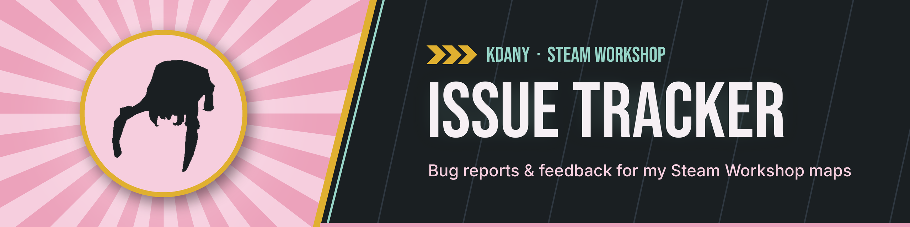

[![Open bugs](https://img.shields.io/github/issues/KDany/steam-workshop/Bug?label=open%20bugs&color=d73a4a&logo=data%3Aimage%2Fsvg%2Bxml%3Bbase64%2CPHN2ZyBmaWxsPSJ3aGl0ZSIgeG1sbnM9Imh0dHA6Ly93d3cudzMub3JnLzIwMDAvc3ZnIiB3aWR0aD0iMTYiIGhlaWdodD0iMTYiIHZpZXdCb3g9IjAgMCAxNiAxNiI%2BPHBhdGggZD0iTTQuNzIuMjJhLjc1Ljc1IDAgMCAxIDEuMDYgMGwxIC45OTlhMy40ODggMy40ODggMCAwIDEgMi40NDEgMGwuOTk5LTFhLjc0OC43NDggMCAwIDEgMS4yNjUuMzMyLjc1Ljc1IDAgMCAxLS4yMDUuNzI5bC0uNzc1Ljc3NmMuNjE2LjYzLjk5NSAxLjQ5My45OTUgMi40NDR2LjMyN2MwIC4xLS4wMDkuMTk3LS4wMjUuMjkyLjQwOC4xNC43NjQuMzkyIDEuMDI5LjcyMmwxLjk2OC0uNzg3YS43NS43NSAwIDAgMSAuNTU2IDEuMzkyTDEzIDcuMjU4VjloMi4yNWEuNzUuNzUgMCAwIDEgMCAxLjVIMTN2LjVjMCAuNDA5LS4wNDkuODA2LS4xNDEgMS4xODZsMi4xNy44NjhhLjc1Ljc1IDAgMCAxLS41NTcgMS4zOTJsLTIuMTg0LS44NzNBNC45OTcgNC45OTcgMCAwIDEgOCAxNmE0Ljk5NyA0Ljk5NyAwIDAgMS00LjI4OC0yLjQyN2wtMi4xODMuODczYS43NS43NSAwIDAgMS0uNTU4LTEuMzkybDIuMTctLjg2OEE1LjAzNiA1LjAzNiAwIDAgMSAzIDExdi0uNUguNzVhLjc1Ljc1IDAgMCAxIDAtMS41SDNWNy4yNThMLjk3MSA2LjQ0NmEuNzUuNzUgMCAwIDEgLjU1OC0xLjM5MmwxLjk2Ny43ODdjLjI2NS0uMzMuNjItLjU4MyAxLjAzLS43MjJhMS42NzcgMS42NzcgMCAwIDEtLjAyNi0uMjkyVjQuNWMwLS45NTEuMzgtMS44MTQuOTk1LTIuNDQ0TDQuNzIgMS4yOGEuNzUuNzUgMCAwIDEgMC0xLjA2Wm0uNTMgNi4yOGEuNzUuNzUgMCAwIDAtLjc1Ljc1VjExYTMuNSAzLjUgMCAxIDAgNyAwVjcuMjVhLjc1Ljc1IDAgMCAwLS43NS0uNzVaTTYuMTczIDVoMy42NTRBLjE3Mi4xNzIgMCAwIDAgMTAgNC44MjdWNC41YTIgMiAwIDEgMC00IDB2LjMyN2MwIC4wOTYuMDc3LjE3My4xNzMuMTczWiIvPjwvc3ZnPg%3D%3D)](https://github.com/KDany/steam-workshop/issues?q=is%3Aissue%20is%3Aopen%20label%3ABug)

[![Reports: English only](https://img.shields.io/badge/Reports-English%20only-blue?logo=data%3Aimage%2Fsvg%2Bxml%3Bbase64%2CPHN2ZyBmaWxsPSJ3aGl0ZSIgeG1sbnM9Imh0dHA6Ly93d3cudzMub3JnLzIwMDAvc3ZnIiB3aWR0aD0iMTYiIGhlaWdodD0iMTYiIHZpZXdCb3g9IjAgMCAxNiAxNiI%2BPHBhdGggZD0iTTggMGE4IDggMCAxIDEgMCAxNkE4IDggMCAwIDEgOCAwWk01Ljc4IDguNzVhOS42NCA5LjY0IDAgMCAwIDEuMzYzIDQuMTc3Yy4yNTUuNDI2LjU0Mi44MzIuODU3IDEuMjE1LjI0NS0uMjk2LjU1MS0uNzA1Ljg1Ny0xLjIxNUE5LjY0IDkuNjQgMCAwIDAgMTAuMjIgOC43NVptNC40NC0xLjVhOS42NCA5LjY0IDAgMCAwLTEuMzYzLTQuMTc3Yy0uMzA3LS41MS0uNjEyLS45MTktLjg1Ny0xLjIxNWE5LjkyNyA5LjkyNyAwIDAgMC0uODU3IDEuMjE1QTkuNjQgOS42NCAwIDAgMCA1Ljc4IDcuMjVabS01Ljk0NCAxLjVIMS41NDNhNi41MDcgNi41MDcgMCAwIDAgNC42NjYgNS41Yy0uMTIzLS4xODEtLjI0LS4zNjUtLjM1Mi0uNTUyLS43MTUtMS4xOTItMS40MzctMi44NzQtMS41ODEtNC45NDhabS0yLjczMy0xLjVoMi43MzNjLjE0NC0yLjA3NC44NjYtMy43NTYgMS41OC00Ljk0OC4xMi0uMTk3LjIzNy0uMzgxLjM1My0uNTUyYTYuNTA3IDYuNTA3IDAgMCAwLTQuNjY2IDUuNVptMTAuMTgxIDEuNWMtLjE0NCAyLjA3NC0uODY2IDMuNzU2LTEuNTggNC45NDgtLjEyLjE5Ny0uMjM3LjM4MS0uMzUzLjU1MmE2LjUwNyA2LjUwNyAwIDAgMCA0LjY2Ni01LjVabTIuNzMzLTEuNWE2LjUwNyA2LjUwNyAwIDAgMC00LjY2Ni01LjVjLjEyMy4xODEuMjQuMzY1LjM1My41NTIuNzE0IDEuMTkyIDEuNDM2IDIuODc0IDEuNTggNC45NDhaIi8%2BPC9zdmc%2B)](#language)

KDany's Steam Workshop Issue Tracker
=================================

Use this repository to report bugs and technical issues for my Steam Workshop maps.

This tracker is currently focused on **Counter-Strike 2** maps, and may expand to other games later.

Please note that this repository is dedicated to bug reports and technical feedback, and **new map requests are not accepted** here.

Maps
----

| Map | Game | Workshop | Subscriptions | Last updated | Source files |
| :--- | :--- | :--- | :--- | :--- | :--- |
| Dust II Long | Counter-Strike 2 | [Workshop page](https://steamcommunity.com/sharedfiles/filedetails/?id=3730804227) |  |  | - |

All of my Workshop items: [KDany's Workshop](https://steamcommunity.com/profiles/76561198011807358/myworkshopfiles/)

Raw Hammer source files of my CS2 maps are available in [KDany/cs2-maps](https://github.com/KDany/cs2-maps). Permission requests (e.g. commercial use) and community variant listings are handled there too.

Language
--------

All issues and comments should be written in **English**.
If needed, please use a translator for your report text.

Code of Conduct
---------------

Please keep discussions respectful and useful:

- Do not insult, harass, or demean anyone.
- Do not intentionally submit duplicate issues.
- Do not use ALL CAPS in issue titles or descriptions.
- Do not repeatedly bump open issues to ask for updates.

Bug Report vs Technical Feedback
--------------------------------

On GitHub, an **issue** is the general report container.
A **bug** is one type of issue.

In this repository there are two issue templates:

- Use **Bug Report** for things that are clearly broken or not working as intended.
- Use **Map Technical Feedback** for things that technically work, but still feel off, unclear, unbalanced, or have a confusing layout.

Typical examples:

- **Bug Report**: getting stuck, clipping, crashes, broken triggers, missing models/textures/sounds, script or entity errors.
- **Map Technical Feedback**: visibility problems, overly dark areas, confusing layout, weak sightlines, balance concerns, or spawn placement feedback.

How to Report a Bug
-------------------

Before opening a new issue:

- Search existing **issues** first, including closed ones: [Issue list](https://github.com/KDany/steam-workshop/issues?q=is%3Aissue)
- If you find the same issue, add a thumbs up reaction to the original report instead of creating a duplicate.

When opening a new issue, include:

- A short, descriptive title
- The game and map name
- Clear reproduction steps
- Expected behavior and actual behavior
- How often it happens (always, sometimes, once)
- Optional: the exact location — stand at the spot, open the developer console, type `getpos` and paste the output
- Optional: your system specs (CPU, GPU, resolution, settings) for performance issues
- Optional: Any useful screenshots or video if available

Submit an Issue
---------------

Use the **issue templates** to keep reports consistent:

👉 **[Open a new issue](https://github.com/KDany/steam-workshop/issues/new/choose)**

For general questions or anything that is not a bug or technical feedback, please use [Discussions](https://github.com/KDany/steam-workshop/discussions).
